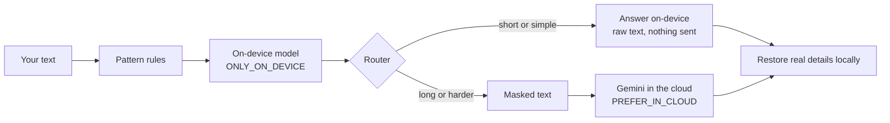

# Airlock

Airlock sits between you and an AI chat. You paste the real thing, with names, PAN numbers, salaries, client names. It finds the private parts on your own device, swaps them for placeholders like `[PERSON_1]`, and only then does anything go to the cloud. When the answer comes back, your real details are put back in locally.

- Live app: https://airlock-af6d7.web.app
- Built for #BuildHybridAI 2026 with Firebase AI Logic hybrid inference
- Works best in desktop Chrome (Gemini Nano). Other browsers get a manual review step instead, see Limits.

## Why

People paste sensitive text into chatbots all the time. Security vendors keep measuring it: Harmonic Security reported sensitive data in about 4% of the prompts it analysed in Q2 2025 ([Axios](https://www.axios.com/2025/07/31/workers-company-secrets-chatgpt)). Most of it is not malicious, it is someone trying to get an email drafted or a quote compared. I wanted something that lets you keep doing that without the real names and numbers leaving your machine.

## How it works



1. **Pattern rules** catch things with a fixed shape: Aadhaar, PAN, phone numbers, email, UPI handles, IFSC codes, Luhn-checked card numbers, API keys. These are plain code and always run.
2. **The on-device model** (Gemini Nano through Firebase AI Logic) finds what patterns cannot: names, employers, places, salaries, internal project names. It returns JSON that matches a schema.
3. **The router** picks where the answer comes from. Short prompts are answered on-device with the raw text, so nothing is sent. Longer or harder ones go to the cloud as masked text only.
4. **The right-hand pane** shows exactly what the cloud received, and the meter counts the bytes.

## Which mode, and why

| Step | Mode | Reason |
|---|---|---|
| Find private details | `ONLY_ON_DEVICE` | It reads raw text, so it must never fall back to the cloud |
| Answer short prompts | `ONLY_ON_DEVICE` | Raw text is safe here because it cannot leave the machine |
| Answer long prompts | `PREFER_IN_CLOUD` | Gets masked text only. If you are offline the SDK falls back to the on-device model |

I did not use `PREFER_ON_DEVICE` for anything that sees raw text. It falls back to the cloud silently when the local model is missing, which would send the raw text.

## When there is no on-device model

Most browsers will not have Gemini Nano. In that case Airlock stops before sending and shows a review step. It pre-selects likely names and amounts, you click anything it missed, and only then is the masked version sent. The same step can be switched on in Chrome with "Check before sending".

## Things that went wrong while building it

- In my first version, Firefox sent a manager's name and a salary to the cloud because only the PAN rule fired and the warning appeared after sending. That is why the review step now blocks first.
- The UPI rule missed `orbit@okhdfcbank.` because of the full stop after it. A unit test now covers it.
- The cloud model once signed an email with `[PERSON_1]`, a token that did not exist, because my prompt mentioned example tokens. It now only sees the tokens that are really in the text.
- The first on-device call took about 18 seconds while Chrome loaded the model, then about 4 seconds. The app now warms the model up in the background on page load.
- Each browser makes its own App Check debug token on localhost, so Firefox got a 401 until I set one fixed token.

## Limits

- Masking is best effort. A small on-device model misses names and over-flags words, which is why a human review step exists. It is not a compliance guarantee.
- Desktop Chrome with enough GPU memory is needed for Gemini Nano. Names in languages other than English are less reliable.
- The on-device model is set to English input and output.
- Image input is not used yet.

## Firebase products used

- **Firebase AI Logic** for hybrid inference (on-device and cloud), structured output and streaming
- **App Check** (debug token) in front of the AI backend
- **Remote Config** for the router's word limit (`router_word_limit`) and a cloud kill switch (`cloud_enabled`). Defaults are used if they are not set
- **Hosting** for the live app

## Run it

Needs Node 22 or newer and Chrome 139 or newer on desktop.

```
npm install
cp .env.example .env     # fill in your Firebase web app config
npm run dev
```

On localhost, open the console, copy the App Check debug token it prints and register it in the Firebase console (App Check, Apps, Manage debug tokens). To use one token in every browser, set `VITE_APPCHECK_DEBUG_TOKEN` in `.env`.

## Tests

```
npm test
```

The tests cover the masking rules and the mask and restore round trip.

## License

Apache-2.0
